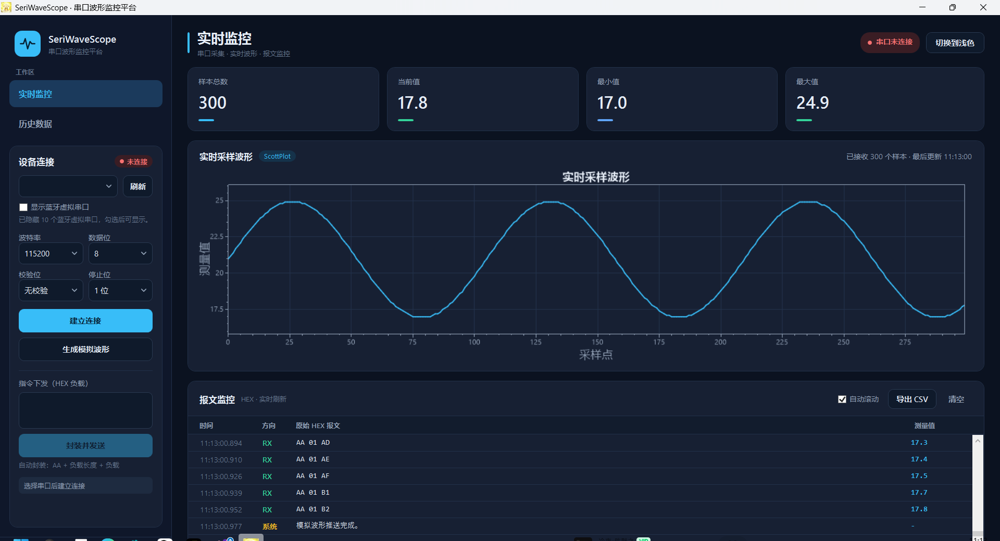
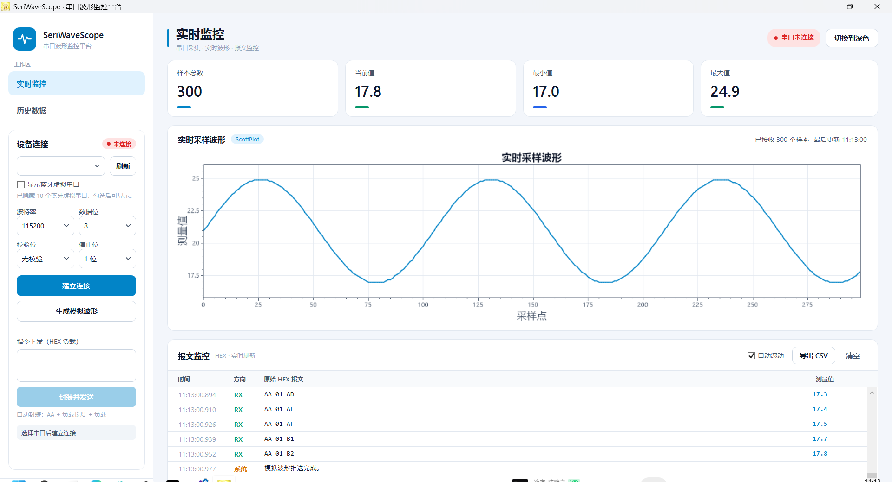
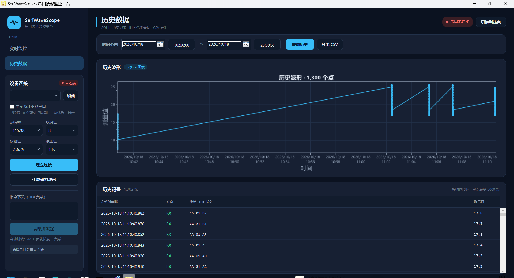
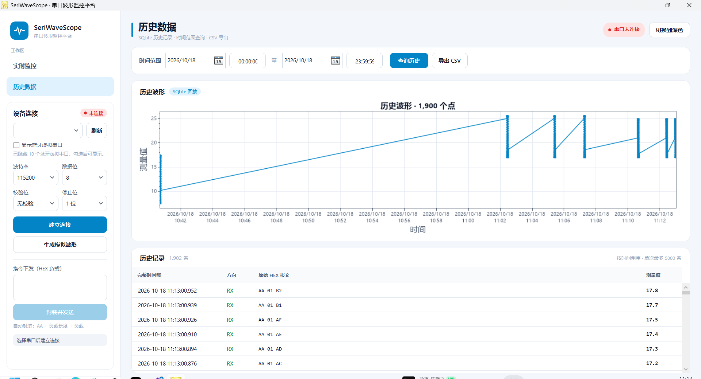

# SeriWaveScope 串口波形监控平台

一个基于 **.NET 8 + WPF + Prism** 的工业串口上位机学习项目，包含实时波形、报文日志、SQLite 历史数据、CSV 导出、深浅主题与无硬件模拟采集。

项目按 **Shell + 业务模块 + 核心契约 + 基础设施** 分层，模块之间只通过事件通信，适合作为 WPF / 上位机方向的简历项目，也适合作为 Prism 模块化改造的练习工程。

## 功能

- 串口扫描：WMI 读取端口描述，默认隐藏蓝牙虚拟串口，可选显示。
- 串口收发：打开 / 关闭、参数配置、HEX 指令发送，帧格式 `AA + 长度 + 载荷`。
- 粘包 / 断包处理：滑动缓冲区按帧头拆包，超时半包自动丢弃。
- 实时监控：样本总数、当前值、最小值、最大值，ScottPlot 波形，报文列表。
- 模拟采集：无需硬件，一键生成 300 帧正弦波数据，走完整的解析、绘图、落盘链路。
- 历史回溯：按时间范围查询 SQLite，显示波形与记录表格，支持 CSV 导出（UTF-8 BOM）。
- 双轨存储：界面日志保留最近 1000 条；SQLite 持久化全部记录；每天一个文本日志文件。
- 主题切换：深色 / 浅色实时切换并持久化，图表颜色同步变化。

## 技术栈

| 方向 | 技术 |
| --- | --- |
| 运行时 | .NET 8（类库 `net8.0`，界面 `net8.0-windows`） |
| 界面 | WPF、自定义控件模板、`DynamicResource` 主题字典 |
| 模块化 | Prism 9.0.537 + DryIoc、Region 导航、EventAggregator |
| 图表 | ScottPlot.WPF 4.1.71 |
| 数据 | Microsoft.Data.Sqlite 9.0.0、SQLitePCLRaw.bundle_e_sqlite3 |
| 串口 | System.IO.Ports 10.0.5 |
| 端口识别 | System.Management 8.0.0（WMI） |

## 架构

```
Yell (Shell)
├── 引用 Yell.Infrastructure
└── 引用 3 个业务模块
        │
        ├── Yell.Modules.Acquisition   串口 / 端口扫描 / 模拟数据
        ├── Yell.Modules.Monitor       实时波形 / 统计 / 报文日志
        └── Yell.Modules.History       SQLite 查询 / 历史波形 / CSV
                    │
                    └── 只引用 Yell.Core（模型、契约、事件、协议）

Yell.Infrastructure ── 实现 Core 中的仓储、日志、导出、设置、对话框
```

- Shell 负责组合根：注册服务、装配模块目录、加载主题、承载 Region。
- 模块之间不互相引用：采集模块发布 `RawPacketReceivedEvent`，监控模块订阅并解析、显示、入库。
- View 负责纯 UI 行为（ScottPlot 缓冲刷新、自动滚动、对话框），ViewModel 负责状态和命令。
- 所有 ViewModel 都由构造函数注入，`DataContext` 在 View 构造函数中显式赋值，不使用 ViewModelLocator。

### 页面与区域

| Region | 内容 |
| --- | --- |
| `HardwareRegion` | 设备连接卡片（AcquisitionView） |
| `MainRegion` | 实时监控（MonitorView）/ 历史数据（HistoryView） |

### 数据流

```
串口 / 模拟数据
   → SerialPortService（FrameParser 拆帧）
   → RawPacketReceivedEvent
   → MonitorViewModel（解析测量值、统计、日志、写 SQLite / 文件）
   → MonitorView（ScottPlot 33ms 刷新）
```

## 目录结构

```
SeriWaveScope.slnx
src/
├── Yell.Core/                         不依赖 WPF 的核心层
│   ├── Constants/                     RegionNames、ViewNames
│   ├── Contracts/                     串口、仓储、日志、CSV、设置、主题等接口
│   ├── Events/                        Prism PubSubEvent 定义
│   ├── Models/                        LogEntry、HistoryRecord、HistoryPoint 等
│   └── Protocol/                      Hex 转换、封包、拆包、测量值解析
│
├── Yell.Infrastructure/               基础设施实现
│   ├── Export/                        CsvExportService
│   ├── Logging/                       FileLogService
│   ├── Persistence/                   SqliteHistoryRepository
│   ├── Services/                      WpfUserInteractionService
│   └── Settings/                      JsonAppSettingsService
│
├── Yell.Modules.Acquisition/          采集模块
│   ├── Models/                        PortInfo
│   ├── Services/                      PortDiscoveryService、SerialPortService
│   ├── ViewModels/                    AcquisitionViewModel
│   ├── Views/                         AcquisitionView
│   └── AcquisitionModule.cs
│
├── Yell.Modules.Monitor/              监控模块
│   ├── Models/                        MonitorStatistics
│   ├── ViewModels/                    MonitorViewModel
│   ├── Views/                         MonitorView
│   └── MonitorModule.cs
│
├── Yell.Modules.History/              历史模块
│   ├── Models/                        HistoryQueryResult
│   ├── ViewModels/                    HistoryViewModel
│   ├── Views/                         HistoryView
│   └── HistoryModule.cs
│
└── Yell/                              Shell 主程序
    ├── Services/                      ThemeService
    ├── Themes/                        Colors.Dark / Colors.Light / Controls
    ├── ViewModels/                    MainWindowViewModel
    ├── Views/                         MainWindow
    ├── App.xaml(.cs)                  PrismApplication 组合根
    └── Yell.csproj
```

## 运行

环境要求：.NET 8 SDK，Visual Studio 2022/2026（或命令行）。

```bash
dotnet build SeriWaveScope.slnx
dotnet run --project src/Yell/Yell.csproj
```

无硬件测试：

1. 启动后停留在「实时监控」。
2. 点击「生成模拟波形」，观察四个指标、正弦波和报文列表。
3. 点击「历史数据」，默认查询当天，查看历史波形与记录。
4. 点击「导出 CSV」验证导出文件。
5. 点击右上角按钮切换深浅主题。

数据位置：

- SQLite：`src/Yell/bin/Debug/net8.0-windows/Data/seriwave_history.db`
- 文本日志：运行目录下 `Logs/yyyy-MM-dd.log`
- 主题设置：`%LocalAppData%\SeriWaveScope\settings.json`

### 用一对虚拟串口测试真实串口链路

界面里的「生成模拟波形」直接发布内部事件，不经过串口。要测试 `SerialPortService` 的打开、接收、拆包，需要一对虚拟串口：

1. 安装虚拟串口驱动，二选一：
   - Virtual Serial Port Driver（Windows 11 下最省事，试用版）：`winget install ElectronicTeam.VirtualSerialPortDriver`
   - com0com（免费开源）：[SourceForge](https://sourceforge.net/projects/com0com/)。Windows 11 开启 Secure Boot 时，旧签名驱动可能安装失败。
2. 在驱动工具里创建一对串口，例如 `COM20 ↔ COM21`。两个端口名不要和已有的蓝牙串口冲突。
3. 上位机刷新串口，选择 `COM21`，参数 `115200 / 8 / 无校验 / 1 位`，建立连接。
4. 另开一个 PowerShell 窗口，把数据写入另一端：

   ```powershell
   powershell -ExecutionPolicy Bypass -File .\tools\send-demo.ps1 -PortName COM20
   ```

   脚本每 10 ms 发送一帧 `AA 01 XX`，测量值在 17.0~25.0 之间按正弦变化；默认无限发送，`-Count 300` 可限制帧数。

5. 监控页应出现实时波形与 RX 报文，历史页可查询到这些数据。

注意：一对虚拟串口的两端只能各被一个程序打开。出现“拒绝访问”时，先关闭占用端口的串口助手或其他实例。

## 协议约定

- 帧格式：`0xAA` + 载荷长度（1 字节）+ 载荷。
- 模拟测量帧：`AA 01 XX`，其中测量值 = `XX / 10.0`。
- HEX 发送：自动封装帧头和长度，载荷上限 255 字节。

## 界面

实时监控（深色）：



实时监控（浅色）：



历史数据（深色）：



历史数据（浅色）：



## 重敲建议顺序

采用「薄壳先立 + 按模块纵向切片」，不要先把三个业务页面全部敲完：

1. Shell 薄壳：`Constants` 和主题契约 → 颜色字典 → 基础控件样式 → `MainWindow` + `ThemeService` + `App`，先让窗口能启动、主题能切换。
2. `Yell.Core`：模型 → 契约 → 事件 → 协议。
3. `Yell.Infrastructure`：SQLite → 文件日志 → CSV → 设置 → 对话框。
4. `Yell.Modules.Acquisition`：PortInfo → PortDiscoveryService → SerialPortService → ViewModel → View → Module，接入 `HardwareRegion`。
5. `Yell.Modules.Monitor`：统计模型 → ViewModel → View（图表 + 日志）→ Module，接入 `MainRegion`，此时跑通模拟采集。
6. `Yell.Modules.History`：查询结果模型 → ViewModel → View → Module，接入导航。
7. 联调收尾：跨页面主题、空状态、CSV、虚拟串口测试、README 截图。

每个模块内部都按：`Model → Service/Contract → ViewModel → View.xaml → View.xaml.cs → Module → App 注册 → F5 验证` 的顺序敲。

## 许可证

见 `LICENSE.txt`。
